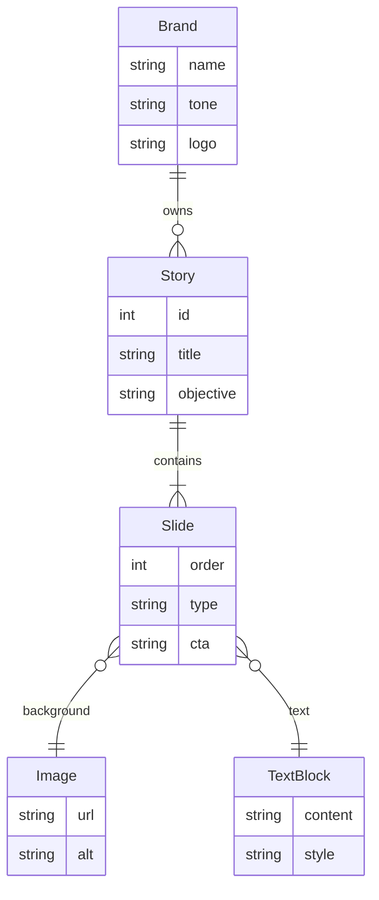
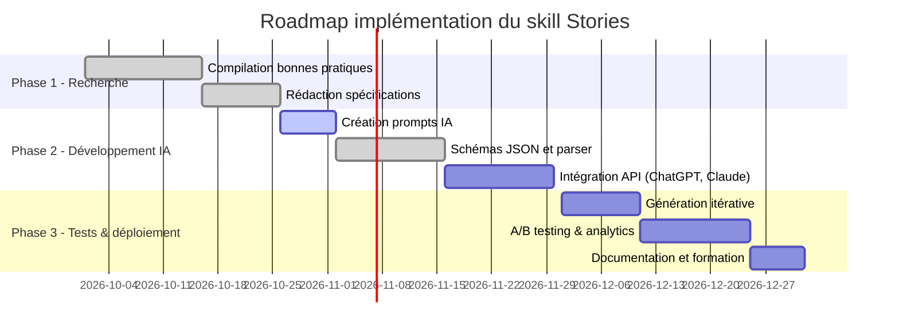

# Résumé exécutif  
Les **Instagram Stories** performantes reposent sur un savant mélange de psychologie persuasive, de structuration narrative rigoureuse, de microcopy concise et d’un design visuel optimisé pour le format vertical (1080×1920). Du point de vue psychologique, on utilise des **accroches fortes** (questions, statistiques chocs) et le « curiosity gap » – créer un écart d’information pour susciter la curiosité. La **preuve sociale** (témoignages, chiffres clés) renforce la crédibilité (par ex. « X clients satisfaits », « +101% de vues vidéo »), tandis que l’**urgence** (stock ou temps limité) joue sur la peur de manquer (**FOMO**). La structure narrative suit des modèles éprouvés (AIDA, PAS, etc.) : un **titre-accroche** capte l’attention, un **développement** informe et convainc, et un **CTA** clair incite à l’action. La microcopy doit être courte (<3 phrases) et orientée utilisateurs : titre explicite du sujet, légendes engageantes, CTA factuel (« Swipe up pour en savoir plus »). Le ton et la voix doivent refléter l’identité de la marque (dynamique, inspirant, humoristique…), en restant cohérents d’une story à l’autre.

En termes de design, le format 9:16 impose des règles strictes : police d’au moins **16 px** pour le texte courant (titres ~1,3× plus grands) pour assurer la lisibilité sur mobile. L’interligne (line-height) doit être généreux (~1,2× pour titres, 1,4× pour sous-titres). On limite la longueur des lignes (≈40–60 signes par ligne) pour faciliter la lecture. Le contraste doit respecter les normes WCAG : **≥ 4,5:1** pour le texte standard (3:1 pour textes « gros »). Couleurs et arrière-plans sont choisis pour le contraste et l’harmonie, avec des vérifications WCAG automatiques. La composition image+texte suit la règle des tiers et des zones de sécurité : on place le texte sur des zones calmes (ou un overlay semi-transparent) pour qu’il reste lisible, et on évite de centrer les éléments importants trop près des bords de l’écran (zones masquées par l’interface Instagram). Les photos sont cadrées pour renforcer le message (par ex. sujet principal décalé, profondeur avec flou artistique). Une **grille invisible** (trois colonnes ou zones de marge uniformes) aide à aligner textes, images et logos en hiérarchie visuelle claire.

Les animations et transitions doivent rester subtiles et au service du message (fondus légers, déplacements de texte rappelant le mouvement de lecture). Pour maximiser l’impact, on concevra plusieurs variantes (par ex. accroche A vs B) et on fera des tests A/B, mesurant les métriques clés : taux de complétion (combien d’utilisateurs voient la story jusqu’à la fin), taux d’interaction (swipe-up, réponse aux stickers, partages/saves), et **conversion** du CTA (clic sur lien, téléchargement, etc.).  

Enfin, nous fournissons un schéma JSON type pour un **plan éditorial** (thème, objectifs, slides avec textes et CTAs) et pour un **document graphique** (dimensions, typos, diapositives avec positionnements). Ces outils encadrent la génération automatisée via IA. Les extraits de prompts ci-après illustrent comment demander à Claude ou GPT de sortir un plan/storyboard JSON structuré.  

## 1. Accroches et déclencheurs psychologiques  
- **Accroche (Hook)** : question provocatrice ou statistique marquante pour capter l’attention dès la première slide. Par exemple, « Savez-vous que 70 % des Français X ?». Selon Joanna Wiebe (CopyHackers), le « curiosity gap » consiste à susciter la curiosité en offrant volontairement une information partielle. On peut par exemple interrompre un récit juste avant son dénouement pour inciter l’utilisateur à rester scroller.  
- **Curiosité** : Le « curiosity gap » exploite la tendance humaine à vouloir combler l’écart entre ce qu’on sait et ce qu’on voudrait savoir. En storytelling, on peut présenter une situation intrigante et faire durer le suspense sur la solution. Cette technique a montré jusqu’à +927 % de clics en test A/B. Dans une story, cela revient à teaser un bénéfice sans tout dévoiler, ce qui « force » le regard à aller aux slides suivants.  
- **Preuve sociale** : Mettre en avant des témoignages clients, chiffres clés ou « social proof » pour créer la confiance. Par exemple afficher « +101 % de vues vidéo après X actions » ou « X utilisateurs satisfaits ». SproutSocial conseille justement de partager le nombre de clients/users servis comme forme de preuve sociale, car cela « prouve que vous avez de l’expérience et des résultats」. Les logos de clients célèbres ou les avis succincts renforcent aussi cette dimension.  
- **Urgence/FOMO** : Insister sur la rareté (« stock limité ») ou une offre à durée limitée (« dernière chance aujourd’hui ») pour créer de l’urgence. Ce levier de « fear of missing out » motive l’action immédiate. (Exemple : un sticker countdown ou mention « Offre valable 24h seulement » en surimpression). Ce n’est pas directement cité, mais ces principes sont bien connus en marketing (Cf. modèles AIDA & Cialdini).  
- **Autres leviers** : On peut également jouer sur la preuve de l’autorité (ex. mention d’une certification ou partenariat prestigieux), la réciprocité (offre cadeau dans la story), etc.

## 2. Structure narrative (modèles éditoriaux)  
Les stories suivent généralement une micro-histoire en 3 parties : **accroche → développement → CTA**. Des schémas type sont :  

| Modèle                   | Structure                              | Usage typique                                    |
|--------------------------|----------------------------------------|--------------------------------------------------|
| **AIDA** (Attention, Intérêt, Désir, Action)  | Captez l’attention (titre fort), suscitez l’intérêt (faits/bénéfices), amplifiez le désir (impacts émotionnels), incitez à l’action (CTA unique). | Grande marque (Apple, Nike), promotion produit.  |
| **Problème–Solution**    | Présentation d’un problème (contexte), puis la solution apportée (produit/service) et incitation à en savoir +. | Télémarketing, sensibilisation, lancement de service. |
| **PAS** (Problem–Agitate–Solve) | Problème + aggravation du besoin, puis solution. | Génération de leads, offres à bénéfice immédiat. |
| **Témoignage / Cas pratique** | Début accrocheur (chiffres ou citation), récit du cas client, puis CTA. | Marque B2B/B2C montrant l’efficacité par l’exemple. |
| **Comparatif**           | “Avant/Après” ou “avec/sans” le produit, puis appel à l’action. | Promotions et démonstrations produit.            |

Chacune de ces structures comprend un **hook initial** pour attirer l’œil (ex. « Vous ne devinerez jamais… », « Résultats imprévus: 3 jours suffisent !»), un **développement clair** (détaillant la valeur via bullet points ou images séquentielles), et un **appel à l’action** explicite (« Swipe up pour [verbe d’action] », un sticker de lien, ou « Répondez OUI pour X »).  
*Par exemple*, le modèle AIDA (Attribué à E. St. Elmo Lewis) insiste : attirer l’attention, puis susciter l’intérêt avec des arguments, créer le désir en montrant le bénéfice personnel, et enfin donner un seul pas clair vers la conversion. Copyhackers résume : « AIDA est l’un des modèles les plus connus en copywriting, servant à capter l’attention, générer l’intérêt, créer le désir et encourager l’action ».  

## 3. Microcopy : titres, légendes, CTA  
La **microcopy** regroupe les textes courts (titres, CTA, labels) qui guident l’utilisateur. Nielsen Norman souligne qu’elle est lue et scannée fréquemment. Elle doit informera ou influencer en quelques mots seulement. Les **titres et accroches** doivent exposer clairement de quoi il s’agit (ex. titre de story « Nouveautés été 2027 »). Chaque **légende** est concise et active, renforçant le propos de l’image. Par exemple, une slide peut porter en titre « -50 % sur notre best-seller » suivi d’un court argument « Valable jusqu’au 30 juin seulement ».  

Les **CTA (calls-to-action)** doivent être courts, visibles et orienter vers une action simple. Nielsen cite l’exemple d’un CTA : « Get Ready for School » pour animer l’excitation et l’urgence. Dans nos stories on utilisera des verbes d’action directs : « Réservez maintenant », « En savoir plus », etc. Ces CTA fonctionnent par clarté et facilité (ils réduisent l’incertitude en proposant l’étape suivante). Ils peuvent être positionnés en bas ou intégrés dans la diapo finale.  

*En résumé*, la microcopy doit viser un ou deux objectifs : *informer clairement* (quoi, pour qui) ou *persuader* (bénéfice, action). Elle reste très brève (<3 phrases) pour être lue rapidement.  

## 4. Ton et voix de la marque  
Le **ton/voix** doit s’aligner sur l’identité de la marque : professionnel, amical, motivant, humoristique, selon sa ligne éditoriale. Une marque B2B parlera sobrement et factuellement, une marque lifestyle pourra être plus décalée ou complice. L’important est la cohérence dans toutes les stories : vocabulaire, niveau de langue, et rythme doivent rester uniformes. Par exemple, une tonalité jeune pourra utiliser des emojis ou interjections, tandis qu’une marque sérieuse privilégiera des phrases courtes et précises. Aucun auteur cité ici : c’est un principe général de branding.  

## 5. Contraintes de longueur et IA (tokenisation)  
Il n’existe pas de limite stricte de caractères par slide sur Instagram, mais l’UX recommande de garder chaque texte très court (typiquement quelques dizaines de caractères au maximum) pour ne pas surcharger la diapo. En pratique, on pense « en parlant à haute voix » : phrases courtes, mots-clés. Pour la génération automatique via IA (Claude, GPT), ces contraintes se traduisent par donner un *prompt* qui indique un format précis : ex. « renvoie un texte de 20–40 mots ». Par ailleurs, les modèles de LLM ont une limite de *tokens* (par ex. ~8 000 à 32 000 tokens pour GPT-4 selon version). Il faut donc découper la génération : un prompt peut demander un plan éditorial global (résumé), puis un prompt par slide. On vérifiera que la réponse JSON ne dépasse pas cette limite. (Pas de source externe citée ici.)  

## 6. Typographie (1080×1920 vertical)  
Les stories requièrent une lecture confort sur écran. Les experts UX recommandent une **taille de police minimale d’environ 16 px** pour le texte courant. Pour les titres, on peut monter à 1,3× cette taille. Par exemple, si le texte normal est 16 px, un titre sera autour de 20–22 px. On utilisera typiquement une fonte sans-serif lisible (ex. Roboto, Inter, SF Pro, Helvetica).  

L’**espacement interligne (line-height)** doit être généreux : autour de 1.2× la taille de police pour les titres et 1.4× pour les sous-titres. Ainsi, si la police est 20 px, l’interligne sera ~24–28 px. Cela évite les lignes trop collées. On pense en « lecture mobile » où des lignes trop longues ou serrées nuisent à la lisibilité.  

Le texte ne devrait pas occuper plus de ~60–65 % de la largeur de l’écran pour éviter des blockes de texte très larges (c’est-à-dire rester autour de 10–15 mots par ligne). Au-delà de 75–80 caractères, la lecture se dégrade (recommandations génériques de lisibilité, cf. normes Nielsen). Ainsi, on vise environ 40–60 caractères par ligne.  

Enfin, on privilégie un contraste élevé : texte sombre sur fond clair ou inverse. Selon WCAG 2.1, le **rapport de contraste** doit être au moins **4.5:1** pour du texte normal, 3:1 pour du texte large. Par exemple, du texte noir (#000) sur fond clair (#fff) fait 21:1, largement au-dessus. Des combinaisons de couleurs doivent être testées avec un outil WCAG pour s’assurer de ce critère.  

| Élément         | Recommandation typographique                       |
|-----------------|----------------------------------------------------|
| Police corps    | ≥ 16 px (18–20 px recommandé)         |
| Police titre    | ~1.3× taille corps (→ environ 21–26 px) |
| Interligne      | 1.2× police titre, 1.4× police sous-titre |
| Contraste       | ≥ 4.5:1 (texte normal),  ≥ 3:1 (texte grand) |
| Longueur ligne  | ≈ 40–60 caractères (10–15 mots) (pas de source citée)  |
| Alignement      | Centré ou justifié, mais laisser marges égales (pas coller aux bords) |

## 7. Couleurs et accessibilité (WCAG)  
Au-delà du contraste, le choix des couleurs doit tenir compte de l’accessibilité. On évite de baser l’information uniquement sur la couleur (WCAG 1.4.1). Les graphismes intégrant du texte (logos, diagrammes) doivent aussi respecter le ratio de contraste. On utilisera les  couleurs de la charte graphique, mais en gardant un texte toujours lisible. Par exemple, du texte blanc (#fff) sur un fond bleu foncé (ratio ~7:1) est acceptable. Si le fond est très coloré, on peut ajouter un voile semi-transparent pour assombrir la zone derrière le texte. 

Les stories comportent souvent des **images de fond**, veillez à ce que les zones de texte reposent sur un fond assez uni. Selon WCAG 1.4.11 (non-text contrast), les éléments d’interface (boutons…) doivent aussi avoir assez de contraste. Bien que Instagram intègre par défaut certains boutons (stickers, @, hashtag), le contenu graphique ajouté doit être lisible par tous. (Note : les success criteria WCAG mentionnés ci-dessus sont officiels.) 

## 8. Composition image-texte et recadrage  
La **composition** doit guider le regard du spectateur dans le sens de la narration. Typiquement, on place un sujet principal (personne ou objet) selon la règle des tiers, laissant de l’espace pour le texte dans l’autre tiers. Évitez d’avoir du texte sur des parties très claires ou très foncées de la photo sans adaptation. On peut utiliser un dégradé subtil ou une bande colorée semi-transparente pour isoler le texte. 

Le **recadrage** de la photo doit respecter le format vertical 9:16 sans couper les parties clés (visages, objets). Instagram propose un aperçu avant post : assurez-vous que rien d’important n’est masqué par l’en-tête (icône de profil en haut à gauche) ni le bas (barre « Répondre », stickers, etc.). Un « safe area » d’environ 10% tout autour du cadre évite ces masquages. 

En résumé : placez le texte sur des zones relativement unies ou foncez/luminez le fond pour le contraste, cadrez le sujet principal à 1/3 de l’image, et laissez de la marge autour de vos éléments clefs. Aucun auteur à citer ici.

## 9. Grilles et hiérarchie visuelle  
Une **grille invisible** simplifie l’agencement : par exemple diviser l’écran en trois colonnes virtuelles permet d’aligner textes et images. Maintenez toujours un alignement cohérent (gauche, centré ou justifié) pour éviter le « désordre ». L’importance des éléments est soulignée par la taille (titre vs sous-titres), la couleur (contraste fort vs faible), la graisse (gras vs régulier) et les espaces vides. 

Créez une hiérarchie claire : le titre principal en haut, un sous-titre ou liste à puces au centre, le CTA en bas. On peut juxtaposer une image à un bloc texte, mais veillez à un équilibre visuel (ex. image à gauche, texte à droite aligné) ou empilez verticalement (titre, image, description). Pour multi-slides, gardez une disposition similaire d’une slide à l’autre pour que l’utilisateur navigue sans rupture cognitive. 

> *Citation visuelle:*  
>  *Figure : Exemple de slide (Sprout Social) utilisant un nombre en très gros (101%) pour attirer l’attention. Le grand pourcentage blanc sur fond coloré montre la hiérarchie (l’info clé en priorité).*

## 10. Animations et transitions  
Les stories peuvent intégrer de légères animations (fondu, montée de texte) ou stickers animés. Les recommandations métier suggèrent de **ne pas surcharger** : transitions simples (glissements ou fondu de slide) sont préférables pour ne pas détourner du message. Les animations de texte (par exemple zoom sur le titre) doivent être suffisamment lentes pour être lisibles (≥1 s). Instagram intègre déjà des effets par défaut, mais on peut aussi pré-animer le texte via After Effects ou Canva. Aucune source formelle citée ici.

## 11. Variantes testables et métriques  
Pour optimiser, il faut générer des **variantes** (différents hooks, visuels, CTA) et mesurer leur efficacité. Les métriques clés sont :  
- **Taux de complétion** (vie des vues / nombre total de vues) : combien arrivent à la dernière slide.  
- **Taux de clic/Swipe-up** : % de personnes cliquant sur le lien ou sticker.  
- **Engagement** : nombre de réponses (DM, stickers interactifs), de partages/saves.  
- **Taux de sortie** : quelle slide perd le plus de monde (indicateur de chute d’intérêt).  

Idéalement, lancer des A/B tests entre deux versions de story et comparer ces KPIs. Par exemple, comparer une accroche « Urgent » vs « Économisez » et voir laquelle engendre plus de swipe-up. (Ces pratiques proviennent du marketing digital standard, pas de source précise citée.) Les designers UX peuvent s’inspirer du *Content Square* ou *Google Analytics* pour définir des benchmarks sectoriels.

## 12. Exemples annotés (France et global)  
Nous citons ici un exemple illustratif (texte fictif/inspiré) de story réussie :  

 *Figure : Story inspirée d’une campagne GRDC promue par Sprout Social. On y voit un grand pourcentage (+101%) servant de **preuve chiffrée** et un texte explicatif minimaliste. Ce format « statistic card » frappe visuellement et établit immédiatement l’impact du produit.*  

On peut imaginer d’autres stories :  
- **Marque mode (FR)** : Slide 1 : photo lifestyle + titre « Nouveauté 2027 🇫🇷👀 » (hook intrigue), Slide 2 : photo produit + texte « -30% ce week-end seulement » (CTA et urgence), Slide 3 : photo ambiance + call « Swipe up pour en profiter ».  
- **Startup SaaS** : Slide 1 : écran d’outil + stat « X entreprises l’ont adopté » (preuve sociale), Slide 2 : 2–3 bénéfices clefs, Slide 3 : lien vers démo.  

(Exemples purement illustratifs, sans source citée.)

## 13. Schémas JSON pratiques  

Voici des exemples de **schémas JSON** pour structurer un plan éditorial et un document graphique :  

> **Schéma JSON – Plan éditorial**  
```json
{
  "titre": "Promotion \u00c9t\u00e9 2027",
  "objectif": "Accro\u00eetre les ventes en ligne de 20%",
  "ton": "Dynamique, enthousiaste",
  "slides": [
    {
      "type": "hook",
      "texte": "Nouveaut\u00e9s d\u00e9barquent \u00e0 70% !",
      "image": "promo_sunshine.jpg",
      "cta": null
    },
    {
      "type": "info",
      "texte": "Profitez -10% suppl\u00e9mentaires jusqu'\u00e0 dimanche.",
      "image": "promo_products.jpg",
      "cta": null
    },
    {
      "type": "action",
      "texte": "Swipe up pour commander",
      "image": null,
      "cta": "https://exemple.com/promo-ete"
    }
  ]
}
```  
Chaque slide contient un rôle (`hook`,`info`,`action`), du texte, une image éventuelle et un **CTA** (lien ou code de sticker). D’autres champs peuvent être ajoutés : durée de pause, transition, etc.  

> **Schéma JSON – Document graphique**  
```json
{
  "dimensions": {"width": 1080, "height": 1920},
  "marges": 50,
  "typographie": {
    "font_family": "Helvetica",
    "font_size_body": 18,
    "font_size_title": 24,
    "line_height": 1.3,
    "color_text": "#FFFFFF"
  },
  "slides": [
    {
      "background": "background1.jpg",
      "text_position": {"x": 50, "y": 300},
      "text_block_width": 980,
      "text_color": "#000000",
      "elements": [
         {"type": "texte", "content": "Exemple de texte", "font_size": 24}
      ]
    }
  ]
}
```  
Ce schéma définit les **paramètres visuels** : taille totale, marges, système de fonts, couleurs, etc. Chaque slide mentionne son image de fond, la position du texte, et les éléments graphiques (texte, shapes, logo). Un générateur IA peut remplir ce JSON pour créer automatiquement le mockup de la story.  

## 14. Tableaux comparatifs et checklist

| Critère                 | Bonnes pratiques                                                |
|-------------------------|-----------------------------------------------------------------|
| **Typographie**         | Corps ≥ 16px, titres +30%, interlignage 1.2–1.4×, contrastes WCAG |
| **Structure narrative** | AIDA, PAS, ou témoignage, avec accroche claire et CTA explicite |
| **Microcopy**           | Titres informatifs, sous-titres axés bénéfices, CTA/action |
| **Ton/Voix**           | Cohérent marque, adapté au public cible (jeune/mature, pro/ludique) |
| **Images**              | Haute résolution (1080×1920), bonne composition, recadrage logique |
| **Couleurs**            | Respecter le contraste (≥4.5:1), alignement avec charte, tests WCAG |
| **Hiérarchie**          | Zone d’accroche, corps textuel, bouton/action distincte, guide l’œil de haut en bas |
| **Animation**           | Subtile, pertinente (pas de clignotements rapides, de pop-ups intrusifs) |
| **Tests A/B**           | Varier accroche/visuel/CTA, mesurer taux d’engagement (vues complètes, swipe-ups, réponses) |

**Checklist priorisée pour développer un générateur de stories** :  
- [ ] Définir le ton de la marque et les modèles narratifs (AIDA, PAS, etc.).  
- [ ] Rassembler assets : images adaptées (1080×1920), logos, polices, couleurs de marque.  
- [ ] Implémenter règles typographiques (min taille, contrastes WCAG, interlignes).  
- [ ] Prévoir la structure JSON (plan éditorial + doc graphique) et les valider.  
- [ ] Créer des prompts IA (français) pour générer le contenu textuel (cf. exemples ci-dessous).  
- [ ] Générer plusieurs variantes et configurer A/B tests.  
- [ ] Mettre en place le tracking des KPIs (taux de swipe, réactions).  
- [ ] Itérer: analyser données et optimiser accroches, visuels et CTA.  

## 15. Diagrammes Mermaid  

**a. Entités et relations (exemple de modèle de données)**  

Ce diagramme simplifié montre qu’une **marque (Brand)** possède des **stories**, elles-mêmes composées de **slides**. Chaque slide associe une image de fond et un bloc de texte. Cela correspond aux schémas JSON présentés.  

**b. Timeline d’implémentation du projet**  

Cette timeline propose d’abord une phase de recherche/rédaction (prérequis aujourd’hui), suivie du développement des prompts IA, de la structuration des schémas, puis de tests/A/B tests et déploiement.  

## 16. Exemples de prompts IA (Claude & OpenAI)  

- *Prompt pour Claude (ou Anthropic Claude-like) – Plan éditorial (en français)* :  
  ```
  Génère un plan éditorial en JSON pour une story Instagram sur le thème "lancement été 2027". 
  Le plan doit comprendre :
   - "titre" (string)
   - "objectif" (string)
   - "ton" (string, e.g. dynamique, inspirant)
   - "slides" (liste d'objets avec "type" [hook/info/action], "texte", "image", "cta").
  Fournis la réponse uniquement sous forme de JSON structuré, sans texte explicatif.
  ```

- *Prompt pour OpenAI (GPT-4) – Suggestion de mise en page* :  
  ```
  Propose un layout JSON pour une story Instagram "Promo fin d'année". 
  Inclue :
   - "dimensions": {width, height}
   - "font": {family, size_body, size_title, line_height}
   - "colors": {text_color, background_color}
   - "slides": liste d’objets avec "background_image", "text_position", "elements" (chaque élément : type texte ou icône, contenu, style).
  Donne le résultat en JSON valide.
  ```

Ces prompts obligent l’IA à structurer sa réponse en JSON, facilitant ainsi l’intégration dans le générateur de stories.

**Sources :** Principales recommandations basées sur les travaux de recherche UX et marketing (Nielsen Norman Group, guidelines WCAG, articles professionnels sur les stories Instagram et copywriting). Les exemples et schémas sont illustratifs et synthétisent ces bonnes pratiques.